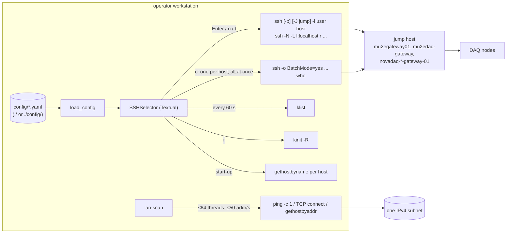

# mu2edaq-cluster-tools

> Operator workstation tools for reaching DAQ nodes, a Textual SSH host picker
> (`ssh-selector`) driven by YAML topology files for Mu2e DAQ, Mu2e offline,
> NOvA DAQ and Fermilab GPVMs, plus `lan-scan`, a rate-limited, size-bounded ICMP and
> TCP-connect sweep of one IPv4 subnet.

| | |
|---|---|
| Repository | `Mu2e/mu2edaq-cluster-tools` (public, issues enabled; #4 open, #3 closed) |
| Language | Python 3.9+ (Textual, PyYAML), shell installers |
| Version | 1.0.1, single source `src/mu2edaq_cluster_tools/_version.py` (package metadata via `pyproject.toml:51`, `ssh-selector --version`, `lan-scan --version`, installers) |
| Ports | binds none; `ssh` to each host's port (default 22); `lan-scan` sends ICMP echo and optional TCP connects (shipped profiles: 22, 80, 443) |
| Depends on | no in-repo package; `ssh`, `klist`, `kinit`, `ping`, `ip`/`ifconfig`/`ipconfig` on the client |
| Tests | 152 pytest cases in 7 modules (+ `conftest.py`, `__init__.py`); pass on Python 3.12.1 and 3.9.6 in this review |
| CI | `.github/workflows/ci.yml`: ubuntu-latest and macos-latest × Python 3.10, 3.11, 3.12; `pip install -e .[dev]` then `pytest`; on push to main/master and on pull requests |

Companion documents: [INTERFACES.md](INTERFACES.md) (command lines, topology
schema, ssh command construction, probe behaviour),
[ISSUES-PENDING.md](ISSUES-PENDING.md) (staged findings), the pre-existing
[`settings.md`](../settings.md) (config reference) and [`README.md`](../README.md).
There is no daemon, so there is no OPERATIONS.md.

## Purpose

`ssh-selector` replaces remembering which DAQ node sits behind which gateway,
under which account (`README.md:13-17`). The topology lives in YAML; the tool
turns a selection into an `ssh` or `ssh -N -L` command line and runs it. It
also shows Kerberos ticket lifetimes, local subnets, and, on request, how many
sessions are open on every host.

`lan-scan` answers "what is alive on this subnet?" by pinging every address,
optionally falling back to TCP connects, and reverse-resolving responders.

Neither tool talks to another package in this superproject. The coupling is
data: the topology files are a fifth copy of the Mu2e node inventory, and
`mu2edaq-config` vendors copies of them.

## Architecture



## Components

### Topology model and loader (`ssh_selector.py:62-209`)

`Host` (`:62-114`) holds `hostname`, `nickname`, `users`, `port`, `proxy_jump`,
`proxy_user` and `group`. `load_config()` (`:144-209`) reads `grouplist`,
`groups` (per-group `users`/`user`, `proxy_jump`, `proxy_user`) and `hosts`,
plus `cache_lifetime` (default 600) and `panel_width` (default 50). A host key
that is present, even as `null`, overrides the group value (`:170-188`). A host
without `hostname` raises `ValueError`; unknown keys are ignored.

`proxy_target()` (`:78-89`) returns `proxy_jump` verbatim if it contains `@`,
else `<proxy_user or destination user>@<proxy_jump>`, with `default` resolved
to `$USER` (`:39-44`). The destination-user default was introduced for issue
#3 (`cba4221`).

### Command construction (`ssh_selector.py:91-114`)

```
ssh [-p PORT] [-J JUMPUSER@JUMP] -l USER HOST
ssh -N -L LOCAL:localhost:REMOTE [-p PORT] [-J JUMPUSER@JUMP] -l USER HOST
```

Arguments are passed as a list (no shell). For a new terminal on macOS the list
is `shlex.quote`d and embedded in AppleScript (`:1595-1603`).

### TUI (`SSHSelector`, `ssh_selector.py:869-1505`)

- Start-up resolves every hostname concurrently (`:1158-1175`) and detects the
  local IPv4 subnets (`:326-370`). A host whose address is inside a local subnet
  skips its jump (`_should_skip_proxy`, `:1183-1194`).
- **Enter / n / t** exit the Textual app with a `ConnectionRequest`; `main()`
  runs the command and then builds a new `SSHSelector` (`:1675-1716`). An
  interactive session runs with `ssh`'s stderr captured (`:1711`) and shown in a
  dialog on a non-zero exit.
- **Background tunnels** are `subprocess.Popen` children with stderr piped and
  never read (`:1322`), polled every 5 s (`:1094`), killed with SIGTERM from the
  panel (`:1392`). Because each loop iteration constructs a new app, the list is
  lost after any Enter, `n` or foreground `t`, and nothing stops them on quit
  (CLU-004).
- **c, Check Users** gathers one `ssh -o BatchMode=yes -o ConnectTimeout=5 …
  who` per configured host with `asyncio.gather` and no concurrency limit
  (`:1430-1470`), each through its own jump connection (CLU-002).
- **Kerberos panel** runs `klist` every 60 s (`:306`); **r** runs `kinit -R`
  (`:1475-1490`).
- **Network panel** gets the local IP from a UDP `connect()` to `8.8.8.8:80`,
  which sends no packet (`:386`).

### Config discovery (`ssh_selector.py:1508-1519`, `:1623-1673`)

`-c FILE`, else every `*.yaml` in `./` then `./config/`; one file loads
directly, several show a picker. No environment variable, user or system
directory is consulted, and `install.sh` installs no topology (CLU-008).

### `lan-scan` (`src/mu2edaq_cluster_tools/lan_scan.py`)

Precedence command line > `LAN_SCAN_*` environment > `--config` YAML > default
(`resolve_option`). Without a network it parses `ip addr show`, else
`ifconfig`, else `ipconfig` (with interface names), drops loopback and
link-local, dedupes and sorts by network; it scans only if exactly one network
remains and names it on stderr, otherwise lists the candidates and exits 1.
Networks with more than `max_hosts` (1024) probe addresses, or globally
routable ones, are refused (exit 3) without `--allow-large` /
`--allow-routable`. Addresses are generated lazily; a pool of `workers`
threads (default 64, max 256) paced by a shared `RateLimiter` (default 50
addresses/s) runs one system `ping` with the platform's `-W`/`-w` unit, then if
it failed a TCP connect to each configured port in turn, then for responders
`gethostbyaddr` in a daemon thread joined with the timeout. Scope and safety
are in [INTERFACES.md §4](INTERFACES.md#4-lan-scan-probe-behaviour).

### Installers

`bootstrap.sh` creates `venv/` and installs `.[dev]` relative to the current
directory (editable with `--dev`). `install.sh` installs into
`$INSTALL_DIR` (default `~/.local/share/mu2edaq-cluster-tools`) and writes
`ssh-selector` and `lan-scan` launchers into `~/.local/bin` or `~/bin`;
`--uninstall` removes `$INSTALL_DIR` recursively (CLU-005).

## Interfaces

Summarised; details in [INTERFACES.md](INTERFACES.md).

- `ssh-selector [-c FILE] | --version`; exit 0, 1 (config problems), 2 (usage).
- `lan-scan [-n CIDR] [-c FILE] [-t S] [-w N] [-r RATE] [--max-hosts N] [--allow-large] [--allow-routable] [-p PORTS] [--no-dns] [--json] | --version`;
  exit 0, 1, 2, 3 (refused: too large or routable).
- Topology YAML schema (`settings.md`, `config/hosts.yaml.example`).
- Outbound: `ssh` (TCP 22 or host port, via jump hosts), ICMP echo, TCP
  connect, DNS.

## Configuration

Six files under `config/` and four under `config/lan-scan/`:

| File | Kind | Hosts | Jump hosts used |
|---|---|---|---|
| `mu2e_daq.yaml` | ssh-selector | 75 in 13 groups | `mu2egateway01.fnal.gov` (62), `mu2edaq-gateway.fnal.gov` (7), none (6) |
| `nova_daq.yaml` | ssh-selector | 222 in 7 groups | `novadaq-far-gateway-01` (207), `novadaq-near-gateway-01` (9), `mu2egateway01` (4), none (2) |
| `mu2e_offline.yaml` | ssh-selector | 22 in 5 groups | none (11), `mu2edaq-gateway` (7), `mu2egateway01` (4) |
| `fnal_gpmv.yaml` | ssh-selector (Fermilab GPVMs) | 35 in 3 groups | none |
| `example.yaml`, `hosts.yaml.example` | ssh-selector examples | 7 each | `gateway.example.com` |
| `lan-scan/lan_scan-mu2edaq.yaml` | lan-scan | `131.225.245.0/24` (routable; needs `--allow-routable`), ICMP only, 16 workers, 20/s | — |
| `lan-scan/lan_scan-mu2edaq-data.yaml` | lan-scan | `10.226.9.0/24`, ports 22/80/443 | — |
| `lan-scan/lan_scan-mu2edaq-ipmi.yaml` | lan-scan | `192.168.246.0/24`, ports 22/80/443 | — |
| `lan-scan/lan_scan.yaml.example` | lan-scan example | `192.168.1.0/24` | — |

Counts are from `load_config()` on the committed files.

### Mu2e DAQ topology as committed

From `git show HEAD:config/mu2e_daq.yaml`:

| Group | Hosts | Jump |
|---|---|---|
| Gateways | `mu2egateway01..03` (3) | none |
| DAQ Control | `mu2e-mgr-01`, `mu2e-dl-01` (no jump), `mu2e-dl-02` | `mu2egateway01` |
| Farm MC2 | `mu2e-worker-01..03` (3) | `mu2egateway01` |
| Farm MC1 | `mu2e-mc1-worker-01..18` (18) | **`mu2egateway01`** (see below) |
| MC1 Control Room | `mu2e-mc1-cr-01..04` (4) | `mu2egateway01` |
| Timing Controls | `mu2e-cfo-01..02` | `mu2egateway01` |
| DCS | `mu2e-dcs-01..02` | `mu2egateway01` |
| **Tracker** | **`mu2e-trk-01..14` (14)** | `mu2egateway01` |
| **Calorimeter** | **`mu2e-calo-01..08` (8)** | `mu2egateway01` |
| Cosmic Ray Veto | `mu2e-crv-01..03` | `mu2egateway01` |
| Stopping Target Monitor | `mu2e-stm-01..02` | none: the group has no `groups` entry |
| Test Stand | `mu2edaq01,04,07,10,11,13,22` (7) | `mu2edaq-gateway.fnal.gov` |
| VNC | `mu2e-mgr-01` six times, users `mu2ecr01..06` | `mu2egateway01` |

Tracker and calorimeter are 14 and 8 nodes. That agrees with
`mu2edaq-diskwatcher` (14/8) and disagrees with `mu2edaq-operations`
`nodes_config.yaml` and `mu2edaq-power-recovery` `topology.yaml` (18/14) and
with power-recovery `power-sequence.yaml` (14/11) (CONTRACT §9.7). The file does
not label the trk/calo groups MC-2; its "Farm MC2" group holds only
`mu2e-worker-01..03`. The copies in `mu2edaq-config/config-*/mu2edaq-cluster-tools/mu2e_daq.yaml`
(three tags) have the same 75 hosts and 14/8, and differ from this file only in
a two-line comment.

**MC1 ingress.** The committed file routes `Farm MC1` through
`mu2egateway01.fnal.gov` (`HEAD:config/mu2e_daq.yaml:61`). The working tree
holds an uncommitted one-line change from another session (2026-10-02) that sets
it to `g2gateway01.fnal.gov`, in line with the 2026-10-02 access survey in
`mu2edaq-trigger-cluster/docs/FINDINGS.md`, which found the MC1 enclave
reachable only through `g2gateway01`. This review did not stage or alter that
change; CLU-001 records the discrepancy. `MC1 Control Room` also uses
`mu2egateway01`; whether those hosts sit behind the G2 gateways was not
determined.

**Jump user.** With no `proxy_user`, the jump login is the destination user.
VNC entries therefore jump as `mu2ecr0N@mu2egateway01`, DCS as
`mu2edcs@…`; whether those accounts can log in to the gateway was not verified.

## Operations

No service. Typical use:

```bash
./bootstrap.sh --dev && source venv/bin/activate
ssh-selector -c config/mu2e_daq.yaml
lan-scan -c config/lan-scan/lan_scan-mu2edaq-data.yaml -w 16 --json
```

or `./install.sh` for per-user launchers (then `ssh-selector -c <checkout>/config/mu2e_daq.yaml`).

## Interactions with other packages

| Package | Relation | Evidence |
|---|---|---|
| `mu2edaq-config` | vendors copies of this package's `config/*.yaml` under `config-*/mu2edaq-cluster-tools/` | `mu2edaq-config/config-main/mu2edaq-cluster-tools/mu2e_daq.yaml` |
| `mu2edaq-diskwatcher`, `mu2edaq-operations`, `mu2edaq-power-recovery` | other copies of the node inventory; counts above | CONTRACT §9.7 |
| `mu2edaq-trigger-cluster` | MC1 access survey naming `g2gateway01` as the only ingress | `mu2edaq-trigger-cluster/docs/FINDINGS.md:16-36` |
| `mu2edaq-discovery` | not used; CONTRACT §9.5 does not apply | — |

## Review findings

Staged in [ISSUES-PENDING.md](ISSUES-PENDING.md); none filed (CONTRACT §9.1).

| ID | Sev | Title |
|---|---|---|
| CLU-001 | S3 | [topology] Farm MC1 jumps through mu2egateway01, but the MC1 enclave's ingress is g2gateway01 |
| CLU-002 | S3 | [ssh-selector] Check Users opens one SSH connection per configured host at once, all through the same jump host |
| CLU-003 | S3 | [lan-scan] no bound on scan size or rate, auto-detect scans whichever network is listed first, and a shipped profile targets a routable site subnet |
| CLU-004 | S3 | [ssh-selector] background tunnels leave the panel after any connection and survive quit; a reused local port silently keeps the old forward |
| CLU-005 | S3 | [install] install.sh takes its target from the generic INSTALL_DIR variable and --uninstall deletes it recursively |
| CLU-006 | S4 | [version] lan-scan --version reports 1.0.0 while the package is 1.0.1 |
| CLU-007 | S4 | [lan-scan] probe timeouts are not what --timeout says: Linux ping -W gets milliseconds, and the DNS timeout is global and ineffective |
| CLU-008 | S4 | [config] ssh-selector looks for host files only under the current directory, and install.sh installs none |
| CLU-009 | S4 | [ci] CI matrix omits Python 3.9, the declared floor and the AlmaLinux 9 system Python |
| CLU-010 | S4 | [hygiene] minor findings from the 2026-10 review (rollup) |

Issue #4 (open; src-layout broke the tests) was fixed by `905d344`
(`pytest.ini: pythonpath = src`); the suite passes. It is not re-filed; the
orchestrator may close it.
